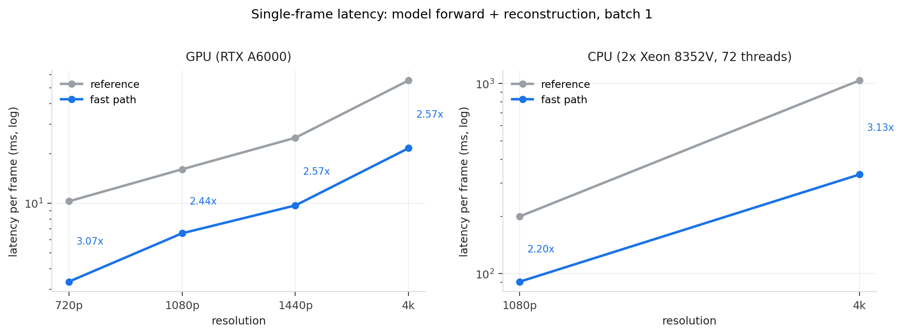
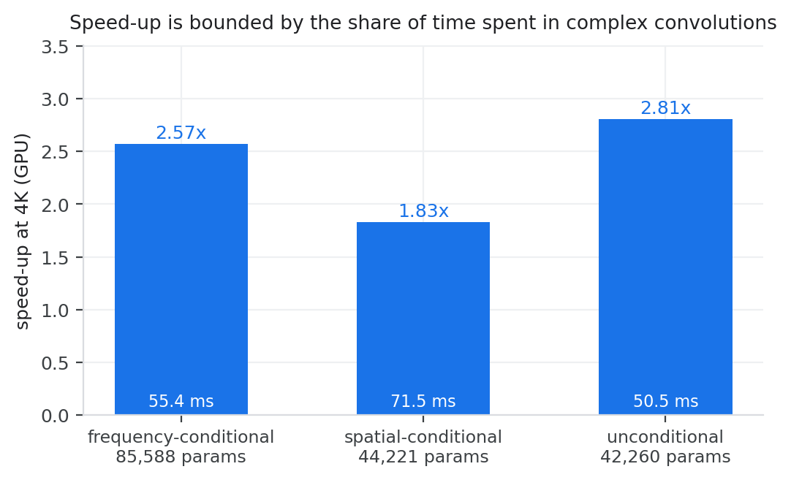

# Efficient inference: 2.4–3.1× faster, same weights, same output

This directory is an **implementation-only** addendum to the paper. It documents
and reproduces a faster execution path for the models in this repository.

Nothing here changes the science: no weight is retrained, no parameter count
changes, no metric in the manuscript moves. The claim is narrow and checkable:

> the checkpoints in `weights/` can be executed 2.4–3.1× faster on the same
> hardware by re-arranging the arithmetic, and the output is identical to
> float32 round-off.

The optimisation was measured after the manuscript was accepted, so it is not
part of the paper. It is included here because the released code is otherwise
the slowest correct implementation of the model, and that is a poor reference
for anyone trying to reproduce or deploy it.



*Single frame = model forward (SLM phase) + backward propagation to the image
plane, batch 1. Speed-ups are annotated between the two curves.*

## Headline numbers

Frequency-conditional model (85,588 parameters), single frame, batch 1, median
of 20 runs after warm-up:

| resolution | RTX A6000 reference | fast path | speed-up | fast path fps |
|---|---|---|---|---|
| 1280×720 | 10.27 ms | **3.35 ms** | 3.07× | 299 |
| 1920×1080 | 16.05 ms | **6.57 ms** | 2.44× | 152 |
| 2560×1440 | 24.90 ms | **9.69 ms** | 2.57× | 103 |
| 3840×2160 | 55.44 ms | **21.55 ms** | 2.57× | 46 |

Same model on CPU (2× Xeon 8352V, 72 threads, shared node — see the note on
measurement below):

| resolution | reference | fast path | speed-up |
|---|---|---|---|
| 1920×1080 | 200.1 ms | **90.8 ms** | 2.20× |
| 3840×2160 | 1039 ms | **333 ms** | 3.13× |

The speed-up depends on how much of a model's time is spent in complex
convolutions, so it differs between the three released models:



`spatial-conditional` gains less (1.83×) because it runs a full-resolution
17→8 real convolution (`input_fusion`) that the packing does not touch — the
reference frame already costs 71.6 ms at 4K before the backbone starts. The unconditional model, which
is pure complex convolution, gains the most (2.81×).

## What the fast path does

Three rewrites. All three are exact algebraic rearrangements; none of them
approximates, quantises or prunes anything.

### 1. One convolution instead of four

`complexPyTorch.ComplexConv2d` evaluates a complex convolution as

```python
(conv_r(x.real) - conv_i(x.imag)) + 1j * (conv_r(x.imag) + conv_i(x.real))
```

That is four real convolutions, two full-size casts to `complex64` and two
non-contiguous `.real`/`.imag` views per layer — seven kernels and two extra
full-resolution temporaries. Stacking the real and imaginary parts along the
channel axis turns the same operation into a single real convolution with the
block weight

```
W = [[ wr, -wi],
     [ wi,  wr]]
```

`utils/fast_complex.py` implements this as a drop-in module and provides
`convert_model()` to swap every complex convolution in a loaded model. Because
the conversion happens *after* `load_state_dict`, no checkpoint key changes.

Replacing the layers one by one is not enough: each replacement still converts
the tensor at its own boundary, and at 4K that traffic costs about as much as
the convolutions that were saved. `PackedBackbone` therefore runs a whole
`CCNN1`/`CCNN2` encoder-decoder in the stacked layout, which is sound because
every non-convolution step of those blocks acts on the two parts
independently (`complex_relu` → `relu`, `_match_complex_size` → `interpolate`,
residual adds → `+`, final `atan2` → `atan2(imag, real)`).

Measured contribution at 1080p on GPU:

| after enabling | ms/frame | speed-up |
|---|---|---|
| — (reference) | 15.5 | 1.00× |
| fused convolutions only | 9.55 | 1.63× |
| + whole-backbone layout | 6.85 | 2.27× |
| + shift-free ASM | 6.63 | 2.34× |
| + cached multiplier | 6.35 | 2.44× |

### 2. The (z, λ) multiplier is not rebuilt every frame

`ConditionalFreqMultiplier` builds a full-resolution
`meshgrid → sqrt → grid_sample` map on every call — 116 ms for a 4K frame, and
it depends only on the conditioning vector, not on the image. `FastCGHInference`
memoises the resampling on the instance (`freq_mult._radial_to_2d`); the model
file is untouched.

### 3. The ASM shift pair cancels

`propagation_ASM` multiplies the spectrum by `H` between an `ifftshift` and an
`fftshift`. Multiplication by a fixed transfer function is a *circular*
convolution, and circular convolution commutes with circular shift, so

```
fftshift(ifft(fft(ifftshift(u)) * H))  ==  ifft(fft(u) * H)
```

exactly, for any `H`. The two rolls only exist to present `H` in a centred
convention. At 4K each roll costs about 19 ms on a 72-thread CPU — more than the
complex FFT itself. `propagation_ASM.set_fast_shift(True)` skips them; the
default is off, so existing callers keep bit-identical behaviour.

This is the one rewrite that silently breaks the physics if you get it wrong: it
is **not** the same as switching to `propagation_ASM2` (`shift_mode='none'`),
which uses an un-shifted `H` and returns a field rolled by half the frame — a
4 dB PSNR "improvement" that is really a shifted image. Keep using the `H`
returned by `propagation_ASM(..., return_H=True)`; do not recompute it. The
frequency grid has a deliberate half-bin inset (`0.5/(2y)`), so a naive
`linspace`-based rebuild is 0.046 % off and also fails.

## Usage

```python
import torch
from conditional_asm_cgh.models.ccnn_cgh_cond_minexp import ConditionalCCNNcghModelMinExp
from conditional_asm_cgh.utils.fast_infer import FastCGHInference

model = ConditionalCCNNcghModelMinExp()
model.load_state_dict(torch.load('weights/spatial_conditional.pth')['model_state_dict'])

engine = FastCGHInference(model, n=2160, m=3840, pitch=0.0036,
                          wavelength=0.000532, z=150.0, device='cuda')
phase, image = engine.run(amp)     # amp: (1, 1, n, m) target amplitude
```

Each rewrite can be switched off (`pack_convs`, `pack_backbones`,
`cache_multiplier`, `shift_free`) to isolate one of them. If you only want the
convolution fusion for a model of your own, use
`convert_model(my_model)` and keep the rest of your pipeline.

## Is the output really unchanged?

Two independent checks, both runnable in a minute.

**Implementation agreement** — `verify_equivalence.py` compares the two
pipelines stage by stage and exits non-zero if anything drifts:

| model | resolution | max abs phase diff | max abs pixel diff | agreement PSNR |
|---|---|---|---|---|
| frequency | 1080p | 1.3e-4 rad | 6.0e-7 | 139 dB |
| frequency | 4K | 8.1e-4 rad | 7.8e-7 | 136 dB |
| spatial | 1080p | 1.1e-4 rad | 4.8e-7 | 141 dB |
| unconditional | 1080p | 4.9e-5 rad | 6.0e-7 | 138 dB |

**Quality against the ground truth** — `quality_ab.py` runs both pipelines on
DIV2K and scores the reconstruction with the metrics the paper reports (18
groups: 2 images × 3 wavelengths × 3 distances, 1080p):

```
mean PSNR   27.4523 dB (reference)  /  27.4523 dB (fast path)
max |dPSNR| 0.00000 dB        max |dSSIM| 5.96e-08
worst pixel difference between the two pipelines: 7.75e-07
```

So the metric does not move; the difference is float32 round-off only.

## Training

The same fused convolution can be used for training. Per-step wall clock, 1080p,
batch 1, RTX A6000:

| | reference | fast path | speed-up |
|---|---|---|---|
| forward | 17.29 ms | 8.54 ms | 2.02× |
| forward + backward | 43.72 ms | 27.34 ms | 1.60× |

The backward pass stays the larger share (80 % of the step after packing versus
61 % before), which is why the training gain is smaller than the inference gain.

Gradients: the packed weight carries the real and imaginary kernel as separate
blocks, so the gradient of one reference `wr` is split across two blocks. Summing
them back (`unpack_packed_grad`) reproduces the reference gradient to a relative
deviation of 2.9e-6 — float32 round-off on a sum of two terms.

One practical consequence: the packed layout holds `4·Cin·Cout` numbers where
the reference holds two tensors of `2·Cin·Cout`. The extra entries are redundant
copies, not new degrees of freedom, but an `Adam` optimiser built before the
conversion will see the wrong parameter count. Convert first, then build the
optimiser, or project the blocks back after each step.

## Reproducing

```bash
# layer-level correctness (fast, no data needed)
python -m conditional_asm_cgh.benchmarks.verify_equivalence --unit

# stage-by-stage agreement, then the full cascade on a real image
python -m conditional_asm_cgh.benchmarks.verify_equivalence \
    --stage all --model freq --resolution 1080p --data-path /path/to/DIV2K_valid_HR

# latency matrix
python -m conditional_asm_cgh.benchmarks.bench_deploy \
    --model freq --device cuda --resolutions 720p,1080p,1440p,4k --reps 20

# quality A/B
python -m conditional_asm_cgh.benchmarks.quality_ab \
    --data-path /path/to/DIV2K_valid_HR --num-images 3

# training step
python -m conditional_asm_cgh.benchmarks.train_equiv \
    --grad-check --time --resolution 1080p

# regenerate the figures from results/*.json
python -m conditional_asm_cgh.benchmarks.make_figures
```

Recorded outputs are in `results/`; the figures above are generated from them.

## Measurement notes

* **Hardware.** GPU: single RTX A6000, 48 GB. CPU: 2× Xeon 8352V (36 cores /
  72 threads each), 400 GB/s, 108 MB L3, 72 threads used.
* **What is being timed.** One frame = model forward + backward propagation +
  `abs()`. Transfer functions and the (z, λ) multiplier are built once, outside
  the timed region, because they are constant for a fixed operating point.
* **CPU numbers are noisy on a shared machine.** Complex 4K convolutions are
  bandwidth-bound, and the reference implementation streams roughly four times
  the bytes of the packed one. Across repeated runs on a loaded node the
  reference moved between 1.0 and 2.7 s per 4K frame while the fast path stayed
  within 330–560 ms; the ratio moves with the load, the absolute values are not
  comparable across machines or across days. The numbers above were taken at
  load average ≈ 15.
* **GPU numbers are stable** to a few percent and are the ones to quote.

## What is *not* optimised

* `input_fusion` and the parameter-map broadcast in the spatial model — full-
  resolution real convolutions, and the reason that model tops out at 1.83×.
* The `cmath`-style `exp(1j·φ)` and `atan2` conversions at the model boundaries;
  they are already a small fraction of the frame.
* Data loading. A faster loader (uint8 cache + 256-entry sRGB LUT instead of the
  float64 `np.where` promotion in `srgb_to_lin`) removes ~130 ms per 4K sample on
  the host side, but with `num_workers ≥ 2` it is hidden behind the GPU step and
  does not change epoch time. It is not included here for that reason.
* Higher-level tricks — pruning, distillation, FP16, TensorRT. Those change the
  numerics and would need their own accuracy study; this directory deliberately
  stays at "same weights, same output".
